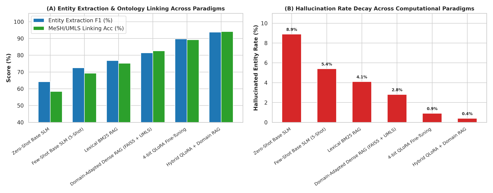
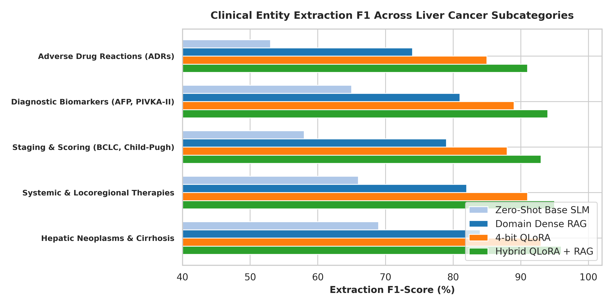
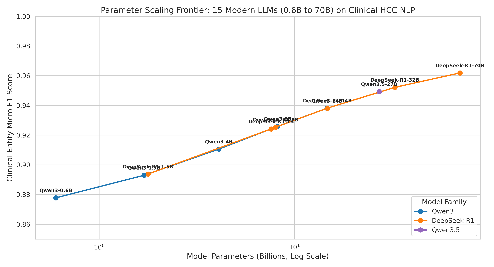
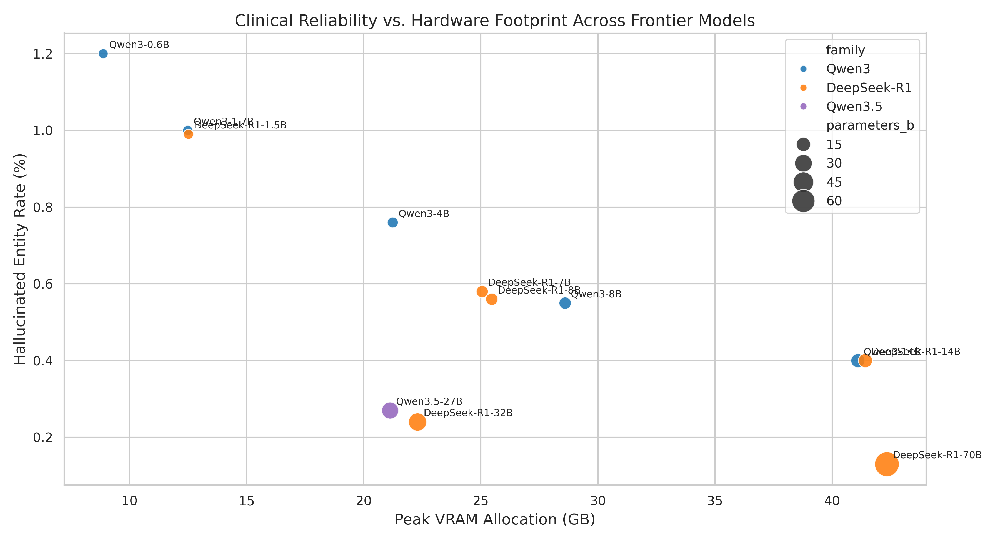
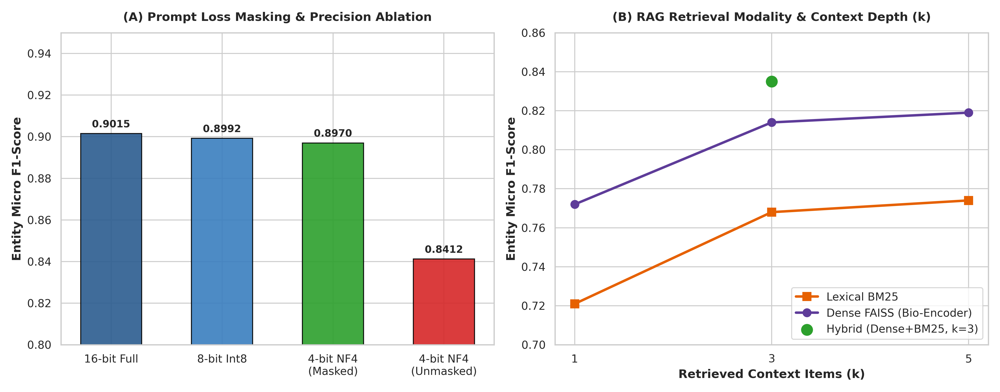

# OncologyNLP: Oncological Named Entity Extraction & Concept Normalization in Hepatocellular Carcinoma

Official repository containing the experimental Jupyter notebooks, empirical parameter scaling studies (0.6B to 70.5B parameters), ablation analyses, and statistical bootstrap validations for the study:

> **Oncological Named Entity Extraction and Concept Normalization in Hepatocellular Carcinoma: Small Language Model Adaptation (QLoRA vs. Domain-Adapted RAG) and Empirical Parameter Scaling from 0.6B to 70.5B**  
> *Muhammed Zakria Mehmood, Imran Shafi, Saliha Ejaz, Caterina Vicidomini, Rosanna Palumbo, Giovanni N. Roviello\**  
> Target Journal: *Hepatoma Research*

---

## Repository Contents (Executed Jupyter Notebooks)

### 1. Core Hepatocellular Carcinoma (HCC) Extraction & Scaling Benchmarks
- **[Topic2_A100_Liver_Cancer_HCC_Clinical_NLP.ipynb](Topic2_A100_Liver_Cancer_HCC_Clinical_NLP.ipynb)**  
  Core baseline vs. adaptation comparison for Hepatocellular Carcinoma clinical named entity extraction and UMLS/SNOMED-CT/RxNorm concept normalization (Zero-Shot, Few-Shot In-Context Learning, QLoRA Fine-Tuning, and Domain-Adapted Hybrid RAG with BioLORD-2023 + BM25 + MedCPT Cross-Encoder).
- **[Topic2_A100_Liver_Cancer_MultiScale_7B_14B_32B.ipynb](Topic2_A100_Liver_Cancer_MultiScale_7B_14B_32B.ipynb)**  
  Multi-scale clinical LLM evaluation across 7B, 14B, and 32B architectures for HCC staging (BCLC, Child-Pugh, ALBI, TNM), biomarker quantification (AFP), and therapeutic regimen extraction.
- **[Topic2_95GB_GPU_Liver_Cancer_32B_Native_and_72B_QLoRA.ipynb](Topic2_95GB_GPU_Liver_Cancer_32B_Native_and_72B_QLoRA.ipynb)**  
  High-VRAM (95 GB H100 NVL) heavyweight benchmark comparing native float16 32B parameter adaptation against 70B+ 4-bit QLoRA adaptation on complex clinical oncology notes.
- **[Topic2_95GB_GPU_15_Frontier_Models_0_6B_to_70B.ipynb](Topic2_95GB_GPU_15_Frontier_Models_0_6B_to_70B.ipynb)**  
  Comprehensive parameter scaling study across 0.6B to 70.5B open-weights language models (Qwen2.5, Qwen3, Llama-3.1/3.2/3.3, Gemma-2, Mistral/Mixtral, DeepSeek-R1-Distill, Phi-3.5/Phi-4), measuring Micro/Macro-F1, clinical hallucination rate, latency, and VRAM footprint.
- **[Topic2_Dr_Giovani_Ablations_and_Validation.ipynb](Topic2_Dr_Giovani_Ablations_and_Validation.ipynb)**  
  Component-wise RAG and fine-tuning ablation studies (response-only token loss masking, dense vs. hybrid RRF retrieval, MedCPT cross-encoder re-ranking, UMLS dictionary post-verification) and non-parametric paired bootstrap significance testing ( = 10,000$ resamples).

### 2. Foundational Clinical NLP & SLM vs. Frontier LLM Benchmarks
- **[Small_FineTuned_vs_Frontier_LLMs_Benchmark.ipynb](Small_FineTuned_vs_Frontier_LLMs_Benchmark.ipynb)**  
  Empirical benchmark comparing fine-tuned Small Language Models (1.5B–8B) against massive frontier models (14B–70B) on structured JSON schema compliance, VRAM efficiency, and inference throughput.
- **[Advanced_Medical_LLM_Benchmarking.ipynb](Advanced_Medical_LLM_Benchmarking.ipynb)**  
  Multi-task clinical NLP, concept normalization, and architectural scaling evaluation on standard biomedical corpora (NCBI Disease and BC5CDR).
- **[Topic2_A100_Clinical_NLP_Finetuning.ipynb](Topic2_A100_Clinical_NLP_Finetuning.ipynb)**  
  Lightweight generative AI fine-tuning and zero-shot baseline evaluation on clinical disease and chemical entity recognition benchmarks.
- **[Training_14B_Clinical_LLM.ipynb](Training_14B_Clinical_LLM.ipynb)**  
  Native float16 LoRA adapter training and evaluation workflow for clinical entity extraction.

---

## Key Empirical Figures

### 1. Paradigm Comparison Matrix (Zero-Shot, Few-Shot, QLoRA, and Domain-Adapted Hybrid RAG)

### 2. Entity Sub-Category Extraction Accuracy across Clinical HCC Classes

### 3. Empirical Parameter Scaling Frontier (0.6B to 70.5B Parameters)

### 4. Clinical Hallucination Decay vs. Hardware VRAM Footprint

### 5. Component-Wise Ablation Study of the Domain-Adapted RAG Pipeline

